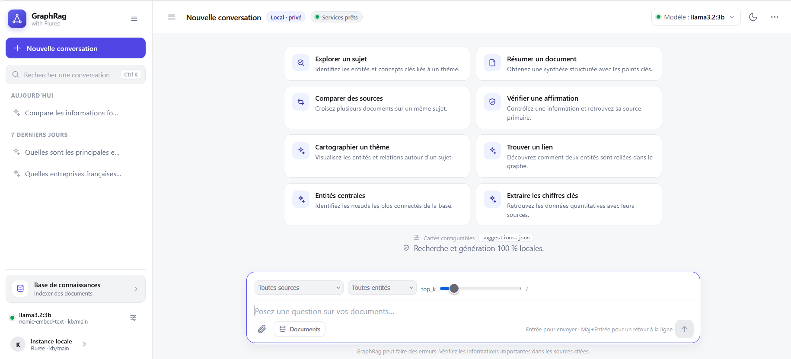
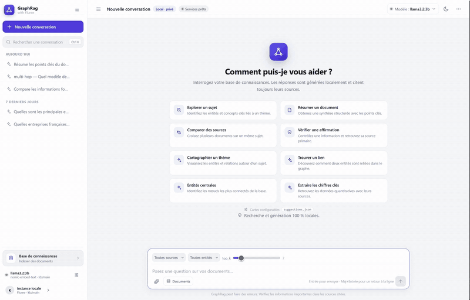
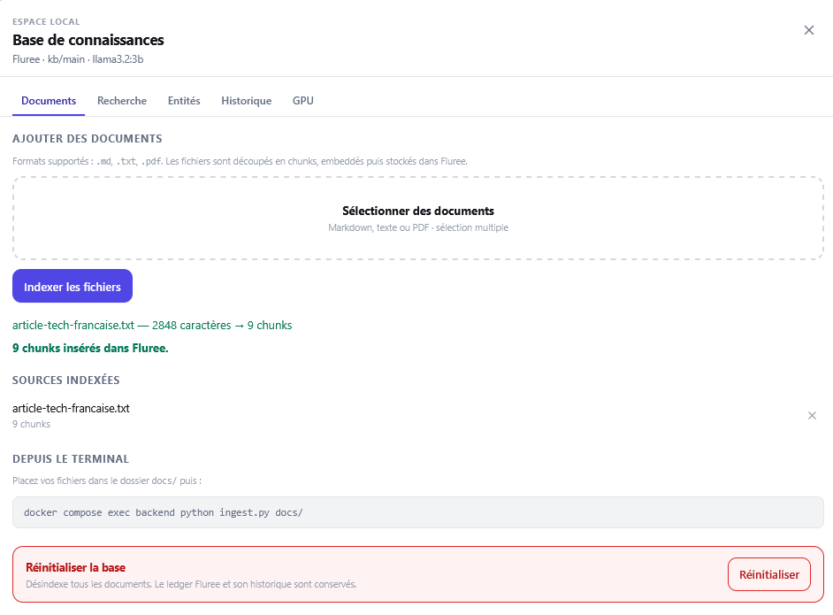

# GraphRag-Fluree 🤖◈

Chatbot **RAG** (Retrieval-Augmented Generation) dockerisé, appuyé sur **Fluree** comme graphe
de connaissances et **Ollama** pour l'inférence locale sur **GPU NVIDIA**. Tout tourne en
local : les réponses sont fiables, citées et traçables — la connaissance provient
exclusivement de vos documents.

<p align="center">
  
</p>

```
┌────────────┐   HTTP/SSE   ┌──────────────┐       ┌─────────────┐
│ Interface  │ ───────────► │   backend    │ ◄────►│   Ollama    │  (GPU NVIDIA)
│    web     │   (port 8000)│   FastAPI    │       │ llama3.2:3b │
└────────────┘              └──────┬───────┘       │ nomic-embed │
                                   │ JSON-LD       └─────────────┘
                                   ▼
                            ┌─────────────┐
                            │   Fluree    │  graphe de connaissances
                            │  (port 8090)│  (ledger kb/main, versionné)
                            └─────────────┘
```

## Démonstration

Indexation d'un dossier, question en streaming et réponse citant ses sources :



## Fonctionnalités

- **Ingestion** de documents Markdown, texte brut et **PDF** (découpage en chunks avec
  recouvrement, embeddings, stockage en JSON-LD dans le graphe Fluree).
- **Chat en streaming** avec citations : chaque affirmation renvoie vers sa source
  (fichier, extrait, score de similarité), sources repliées sous la réponse et dépliables
  d'un clic.
- **Ingestion d'un dossier entier** depuis l'interface, avec barre de progression
  fichier par fichier et bilan des échecs sans interrompre les fichiers suivants.
- **Graphe de connaissances complet** : Fluree est un ledger immuable et versionné ;
  l'historique de chaque donnée qui alimente les réponses est consultable.
- **100 % local** : aucun appel à un service IA tiers.

## Prérequis

| Élément | Note |
|---|---|
| Docker + Compose v2 | `docker compose version` |
| nvidia-container-toolkit | Nécessaire pour exposer le GPU aux conteneurs |
| Carte NVIDIA ≥ 6 Go VRAM | Testé avec une RTX 3060 (6 Go) |

### Installation de nvidia-container-toolkit (si absent)

```bash
sudo apt-get update
sudo apt-get install -y nvidia-container-toolkit
sudo nvidia-ctk runtime configure --runtime=docker
sudo systemctl restart docker
```

Vérification (optionnelle mais recommandée) :

```bash
docker run --rm --gpus all --device /dev/nvidia0:/dev/nvidia0 nvidia/cuda:12.4.1-base-ubuntu22.04 nvidia-smi
```

## Démarrage rapide

```bash
docker compose up -d --build
```

Au **premier** démarrage, le service `ollama-init` télécharge les modèles (~2,5 Go) :

```bash
docker compose logs -f ollama-init     # surveiller le téléchargement
docker compose ps                      # tout doit être Up / healthy
```

Ouvrez ensuite **http://localhost:8000** :

1. Onglet **GPU & modèles** → vérifiez que `llama3.2:3b` apparaît avec une utilisation VRAM
   (le GPU est bien actif).
2. Onglet **Documents** → indexez les fichiers d'exemple fournis (`docs/`) soit via
   l'interface, soit :

   ```bash
   docker compose exec backend python ingest.py docs/
   ```

3. Posez des questions, par exemple :
   - « Quels sont les services Docker de l'application ? »
   - « Comment vérifier que le GPU est utilisé ? »
   - « Mes données partent-elles sur Internet ? »

## Utilisation

### Interface web (http://localhost:8000)

- **Chat** : questions en streaming, réponses citées avec les sources récupérées, historique local et export Markdown.
- **Documents** : sélection de plusieurs fichiers ou d'un **dossier entier** (`.md`, `.markdown`, `.txt`, `.pdf`, sous-dossiers compris), barre de progression de l'indexation, rapports par fichier, **désindexation d'une source** (bouton `×` sur chaque ligne) et **réinitialisation de la base** (zone rouge en bas de l'onglet). Les deux demandent une confirmation.
- **GPU & modèles** : état du GPU vu par Ollama et modèles chargés.
- **Suggestions** : les cartes de l'écran d'accueil sont configurables dans `backend/app/static/suggestions.json`.

<p align="center">
  
  <br>
  <em>Onglet « Documents » : dépôt de fichiers ou d'un dossier, sources indexées et réinitialisation de la base.</em>
</p>

### API

| Méthode | Endpoint | Rôle |
|---|---|---|
| `POST` | `/api/chat` | `{"question": "..."}` → réponse en SSE (événements `token`, `sources` avec extrait, `done`) |
| `POST` | `/api/search` | `{"question": "...", "top_k": 7, "source": "...", "entity": "..."}` → renvoie les chunks les plus pertinents (sans génération) ; `source` et `entity` sont des filtres optionnels |
| `POST` | `/api/ingest` | Multipart `files` → indexe des documents dans Fluree ; un nom portant un chemin (`dossier/sous/a.md`) est conservé comme source |
| `DELETE` | `/api/sources?source=…` | Désindexe une source (chunks marqués obsolètes, ledger conservé) |
| `POST` | `/api/reset` | Réinitialise la base (tous les chunks désindexés, ledger et historique conservés) |
| `GET`  | `/api/status` | Ledger, modèles, état des services |
| `GET`  | `/api/sources` | Sources actives du graphe et nombre de chunks par source |
| `GET`  | `/api/entities` | Entités mentionnées par les chunks actifs, avec type et fréquence |
| `GET`  | `/api/gpu` | Utilisation GPU / VRAM vue par Ollama |
| `GET`  | `/api/history` | Historique des transactions du ledger, tel qu'exposé par Fluree |

### CLI d'ingestion

```bash
docker compose exec backend python ingest.py docs/            # dossier récursif
docker compose exec backend python ingest.py docs/faq.md      # un fichier
```

## Évaluer les réponses (jeu de questions pièges)

Un harnais d'évaluation pose 10 questions pièges (multi-hop, négation, pièges
temporels, hallucination…) et compare les réponses aux réponses attendues :

```bash
docker compose exec backend python eval_rag.py
```

- Ingère tous les documents de `docs/` puis génère `eval_results.json`
  (à récupérer avec `docker compose cp backend:/app/eval_results.json .`).
- Pour chaque question : **score 0-1** (cosinus sur embeddings *calibré* : le
  plancher de similarité du modèle — 0,6 par défaut — est retiré, sans quoi une
  réponse hors sujet obtenait déjà ~0,6 par simple effet du modèle ; fallback
  lexical si les embeddings échouent) + les **extraits récupérés** (source,
  index, score de similarité, extrait) pour distinguer un échec de recherche
  (*retrieval*) d'un échec de génération.
- Une question est comptée comme réussie au-dessus de `--threshold` (0,55 par
  défaut) ; `--floor` règle le plancher d'embeddings.
- Les questions marquées `expected_absence` exigent une information **absente du
  document** : le score vaut 1 seulement si le refus est **propre**, 0,5 si le
  modèle refuse puis spécule (le cas dangereux), 0 s'il invente. C'est le test
  clé contre l'hallucination.
- Une question couverte par le corpus qui reçoit un refus vaut 0 : refuser n'est
  pas une réussite par défaut.
- Jeu de test sur mesure : `tests/eval/qa_france2030.json` (10 questions).

## Configuration (variables d'environnement)

Toutes les variables du service `backend` sont pilotables sans éditer le compose :

```bash
cp .env.example .env      # puis ajustez les valeurs utiles
```

`.env` est ignoré par git ; `.env.example` documente chaque variable et sa valeur
par défaut. Les principales :

| Variable | Défaut | Rôle |
|---|---|---|
| `CHAT_MODEL` | `llama3.2:3b` | Modèle de génération (voir FAQ pour changer) |
| `EMBED_MODEL` | `nomic-embed-text` | Modèle d'embeddings |
| `TOP_K` | `7` | Nombre de chunks injectés dans le prompt |
| `RETRIEVAL_MIN_SCORE` | `0.3` | Seuil de similarité : en dessous, le chunk est écarté (réduit le bruit et les réponses inventées) |
| `CHUNK_SIZE` / `CHUNK_OVERLAP` | `500` / `80` | Découpage des documents |
| `FLUREE_LEDGER` | `kb/main` | Nom du ledger (base) dans Fluree (ne pas réutiliser le nom d'un ledger supprimé : « Ledger has been retracted ») |
| `INDEX_CACHE_DIR` | `/tmp/graphrag-index-cache` | Cache disque de l'index vectoriel (évite de rapatrier tous les embeddings à chaque redémarrage) |
| `INDEX_CACHE_MAX_MB` | `256` | Budget mémoire du cache d'index ; au-delà, l'index n'est pas gardé en mémoire (`0` = cache mémoire désactivé). Évite que le processus backend grossisse sans limite sur un gros corpus |
| `INDEX_CACHE_MAX_ENTRIES` | `32` | Nombre maximal de fichiers d'index conservés sur disque (un par version) |
| `API_TOKEN` | *(vide)* | Si défini, exige `X-API-Token` ou `Authorization: Bearer` sur les endpoints de chat, recherche, ingestion, sources, entités et historique (comparaison à temps constant) |
| `MAX_CONCURRENT_CHATS` | `2` | Générations simultanées autorisées (protection GPU) |
| `MAX_UPLOAD_SIZE` / `MAX_TOTAL_UPLOAD_SIZE` | `50 Mo` / `200 Mo` | Limites par fichier / par requête |
| `MAX_UPLOAD_FILES` | `20` | Nombre maximal de fichiers par requête |
| `MAX_QUESTION_LENGTH` / `MAX_TOP_K` | `4000` / `50` | Bornes de validation de l'API |

## Désindexer un document / réinitialiser la base

Depuis l'interface (onglet **Documents**) ou par l'API :

```bash
curl -X DELETE 'http://localhost:8000/api/sources?source=docs/faq.md'
curl -X POST   http://localhost:8000/api/reset
```

La désindexation est **logique**, pas physique : Fluree est un ledger immuable, donc
les chunks sont marqués `rag:obsolete` (comme lors d'une ré-ingestion) au lieu d'être
effacés. Conséquences :

- les chunks disparaissent de la recherche et des réponses immédiatement (index de
  recherche invalidé) ;
- l'historique et la traçabilité restent intacts, et une nouvelle ingestion du même
  fichier réactive ses chunks ;
- `POST /api/reset` vide la base de la même façon. Il ne supprime pas le ledger :
  c'est volontaire, car un `drop` laisse un « tombeau » qui interdit de réutiliser le
  nom (`Ledger has been retracted`). Pour une remise à zéro complète (modèles + ledger),
  utilisez `docker compose down -v`.

## Comment ça marche

1. **Ingestion** : un document est découpé en chunks (~500 caractères, recouvrement 80),
   chaque chunk est embeddé (`nomic-embed-text`, 768 dimensions) et inséré dans Fluree en
   JSON-LD : sujet `rag:Chunk`, prédicats `rag:content`, `rag:embedding`, `rag:source`,
   `rag:chunkIndex`, `rag:obsolete` et, si des entités sont détectées, `rag:mentions` vers
   des nœuds `ent:*`. Lors d'une ré-ingestion, les anciens chunks de la source sont marqués
   `rag:obsolete` (ils ne sont plus renvoyés par la recherche) ; les chunks ré-indexés
   conservent un `@id` stable dérivé de leur contenu. En CLI, la source est le chemin relatif
   au répertoire courant (deux fichiers homonymes dans des sous-dossiers restent distincts).
   Une insertion partielle est annulée (chunks déjà insérés marqués obsolètes).
2. **Question** : un **index unique** du ledger (matrice d'embeddings L2-normalisée +
   métadonnées) est construit une fois puis mis en cache mémoire (borné par
   `INDEX_CACHE_MAX_MB`) et sur disque ; les filtres `source` et `entité` restreignent
   cet index au lieu de réindexer le corpus. L'embedding de la question est comparé par
   similarité cosinus aux chunks ; les `TOP_K` plus proches sont retenus après
   application du seuil `RETRIEVAL_MIN_SCORE`. Un chunk dont une entité — lue dans les
   `rag:mentions` du graphe — est citée dans la question reçoit un bonus borné, appliqué
   **avant** la troncature au `TOP_K`. Le cache est invalidé automatiquement après toute
   ingestion, y compris via la CLI (`ingest.py`), grâce à un marqueur partagé entre
   processus.
3. **Génération** : le prompt contient le contexte récupéré et ordonne au modèle de répondre
   uniquement à partir de celui-ci, en citant les sources `[1]…[k]`. La réponse est
   diffusée en streaming (SSE).

La recherche par similarité cosinus (produit matriciel sur un index local) convient à une base
de quelques milliers de chunks. Pour passer à l'échelle, Fluree propose une recherche
vectorielle dédiée (service `fluree/search-httpd`) — l'architecture du projet est prévue
pour remplacer `app/retriever.py` sans toucher au reste.

## Depannage

**Le GPU n'est pas détecté par Ollama** → installez/configurer nvidia-container-toolkit
(voir Prérequis), puis `docker compose up -d --force-recreate ollama` et vérifiez
`docker compose logs ollama` (doit afficher `inference compute id` / le GPU).

**Erreur de permission sur `fluree-data`** → le conteneur Fluree tourne avec l'UID 1000 :
`sudo chown -R 1000:1000 ./fluree-data` (uniquement si vous montez un dossier hôte).

**Réponse « Je ne dispose pas de cette information… »** → la question sort du champ de la
base : indexez les documents pertinents. Vérifiez aussi `TOP_K` et les scores affichés.

**Mémoire VRAM insuffisante** (OOM) → fermez les autres applications GPU, ou passez à un
modèle plus léger (`phi4-mini:3.8b`) en modifiant `CHAT_MODEL` puis
`docker compose exec backend python -c "import urllib.request; ..." ` (ou redémarrez
`ollama-init` avec le nouveau modèle).

**Tout est vide après `docker compose down -v`** → normal : les volumes (graphe + modèles)
ont été supprimés ; relancez et ré-indexez.

## Sécurité / production

- L'image Fluree supporte l'authentification par token (`did:key` / OIDC) : activez
  `FLUREE_DATA_AUTH_MODE=required` et `FLUREE_ADMIN_AUTH_MODE=required` si le service est
  exposé au-delà de la machine locale.
- Aucune donnée n'est envoyée à l'extérieur ; le déploiement est pensé pour un usage
  local / réseau privé.
